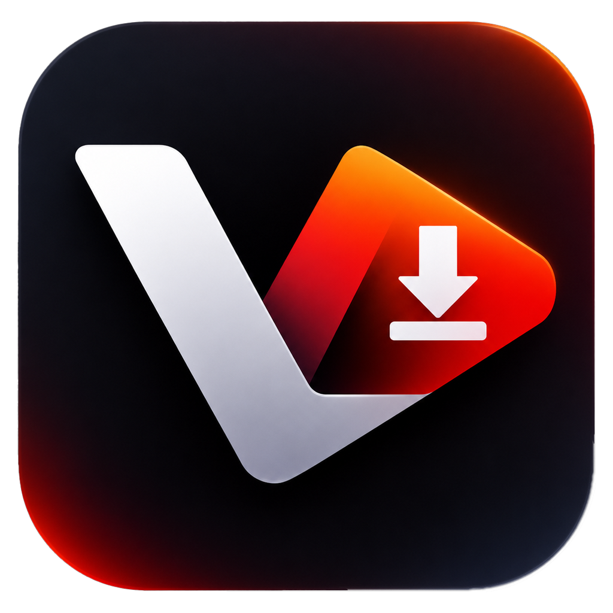
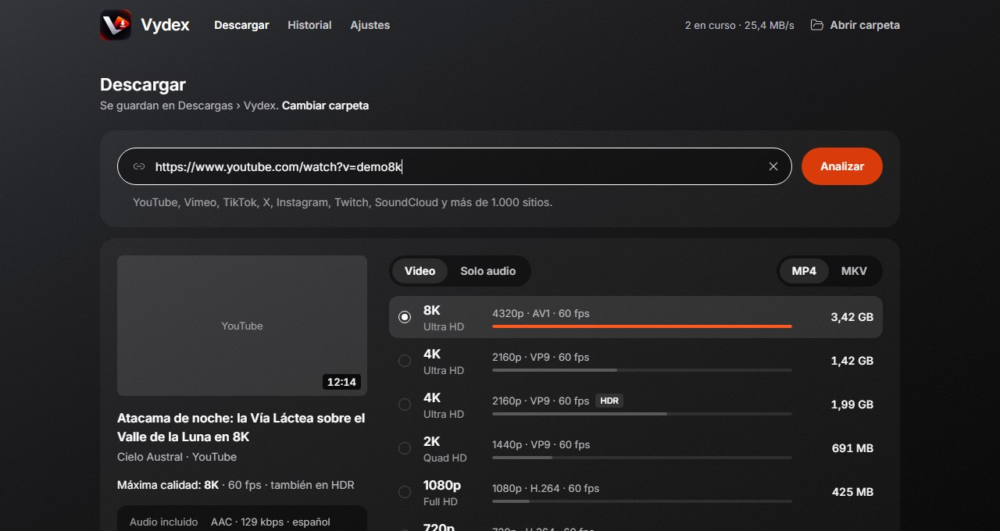
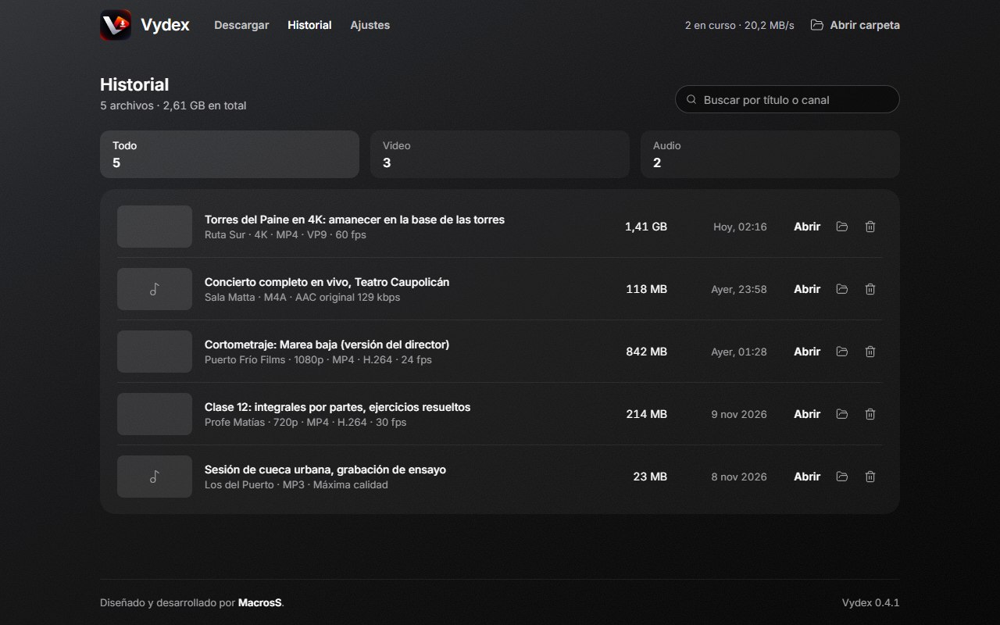
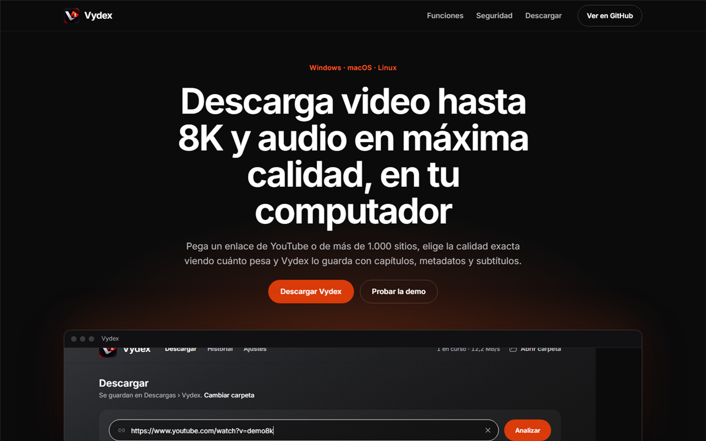
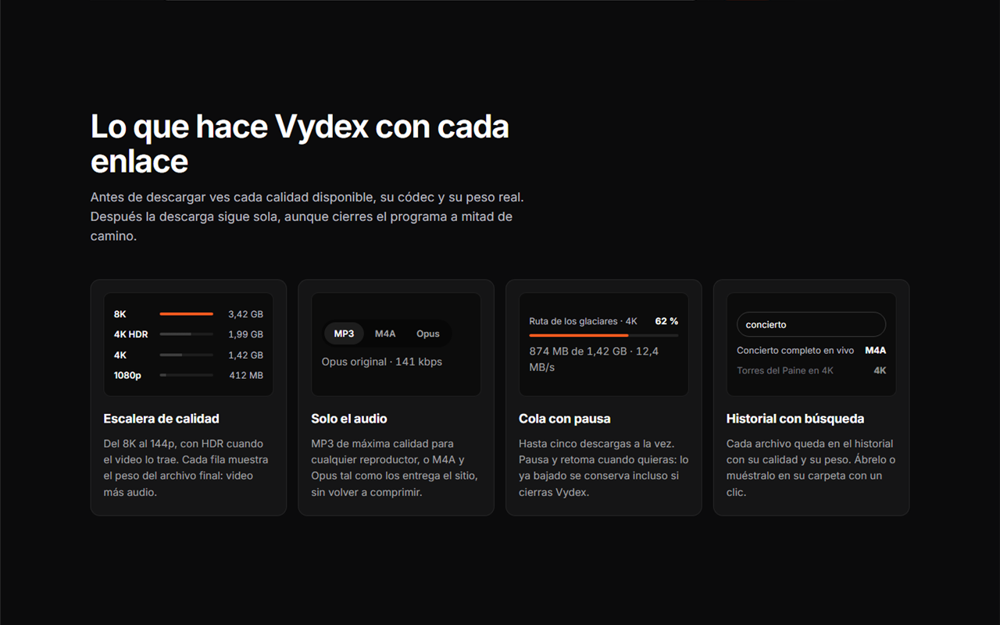

<p align="center"></p>

# Vydex

Programa de escritorio para descargar video hasta **8K y HDR**, y audio en **MP3, M4A u Opus**, desde YouTube y más de 1.000 sitios. En español e inglés. Diseñado y desarrollado por [MacrosS](https://www.linkedin.com/in/felipelucero/).

- Elige la calidad exacta en la "escalera de calidad", con el peso real de cada opción.
- Cola de descargas con pausa, reanudación y varias descargas a la vez.
- Historial con búsqueda, y archivos con capítulos, metadatos y subtítulos.
- Todo ocurre en tu computador: sin cuentas, sin servidores intermedios y sin límites diarios.

**[Sitio web y demo](https://macross95.github.io/vydex/)** · **[Descargar la última versión](https://github.com/macross95/vydex/releases/latest)**

<p align="center"></p>

## Capturas

| El historial | El sitio web |
|---|---|
|  |  |

<p align="center"></p>

Pruébalo sin instalar nada: la [demo en el navegador](https://macross95.github.io/vydex/demo/?demo) muestra la interfaz con datos de ejemplo.

## Sistemas compatibles

| Sistema | Instalador |
|---|---|
| Windows 10 y 11 (64 bits) | `Vydex_<versión>_x64-setup.exe`, con el diseño de Vydex e instalación sin permisos de administrador |
| macOS 11 o superior (Apple Silicon e Intel) | `.dmg` |
| Linux (Ubuntu, Debian, Fedora y otras) | `.deb`, `.rpm` o `.AppImage` |

iPhone, iPad y Android no son compatibles: no permiten que una app ejecute los componentes de descarga.

## Estructura

| Carpeta | Contenido |
|---|---|
| `app/` | El programa: interfaz (`src/`), núcleo (`src-tauri/`) y scripts de compilación (`scripts/`) |
| `app/src/instalador/` | Interfaz del instalador y desinstalador de Windows |
| `app-instalador/` | Núcleo del instalador de Windows |
| `marca/` | Logo original y fuente de los íconos |
| `docs/` | Sitio web (GitHub Pages) y la demo del programa en el navegador (`npm run demo:sitio` la actualiza) |

## Compilar en Windows

```powershell
cd app
npm install
node scripts/motores.mjs windows          # solo la primera vez: baja los componentes de descarga (~120 MB) y los verifica
npm run tauri dev                         # abrir en modo desarrollo
node scripts/empaquetar-instalador.mjs    # instalador en instalador/Vydex_<versión>_x64-setup.exe
```

El instalador es un solo `.exe`: el programa de instalación más un paquete con Vydex. Instala por usuario en `%LOCALAPPDATA%\Vydex`, crea los accesos directos, aparece en "Aplicaciones instaladas" y deja `Desinstalar Vydex.exe` en la carpeta. Al actualizar, la versión nueva se extrae aparte y solo reemplaza a la anterior si todo salió bien. Al terminar, el script revisa que el instalador encuentre su paquete (`--verificar-paquete`).

**Componentes de descarga:** `app/scripts/motores.lock.json` fija la versión y la huella SHA-256 de yt-dlp, Deno y FFmpeg para cada sistema. Si un archivo no coincide, la compilación falla. Para actualizarlos: `node scripts/motores.mjs --fijar` (cruza la suma del proveedor con la que publica GitHub), revisa el cambio y súbelo.

**Versión:** se cambia solo en `app/package.json`. El programa, el instalador y "Aplicaciones instaladas" la leen desde ahí.

**Datos de Vydex en cada equipo:**

| Qué | Dónde (Windows) |
|---|---|
| Ajustes, historial y cola | `%APPDATA%\com.vydex.app\vydex.json` (se guarda de forma atómica; si se daña, se aparta como `vydex.danado-<fecha>.json`) |
| Copia de yt-dlp, caché, descargas a medio bajar y registros de errores | `%LOCALAPPDATA%\com.vydex.app\` |

Vista previa sin compilar el núcleo (datos de ejemplo):
- Programa: `npm run build && npx vite preview` y abrir `http://localhost:4173/?demo` (inglés: `?demo&lang=en`).
- Instalador: `npx vite build --config vite.instalador.config.ts && npx vite preview --config vite.instalador.config.ts` y abrir `http://localhost:4174/instalador.html?demo=1`.

## Compilar para los 3 sistemas (GitHub Actions)

1. Sube el repositorio a GitHub. Los componentes de descarga no se suben (`.gitignore`): el flujo los baja en cada compilación.
2. En el repositorio: **Actions → Compilar Vydex → Run workflow**.
3. Al terminar (unos 20 minutos), los instaladores quedan en **Releases** como borrador.

También se ejecuta al subir una etiqueta de versión: `git tag v<versión> && git push origin v<versión>` (la misma versión de `app/package.json`).

## Antes de publicar

- **Firma de código.** Sin firma, Windows muestra SmartScreen y macOS bloquea la app la primera vez (clic derecho → Abrir). Se resuelve con un certificado de firma de código en Windows y una cuenta de Apple Developer en macOS. En Windows, define `VYDEX_FIRMAR` con el comando de firma antes de empaquetar (por ejemplo `signtool sign /fd sha256 /tr http://timestamp.digicert.com /td sha256 /a`): el script firma `vydex.exe` y el instalador final en el orden correcto. No firmes `vydex-instalador.exe` por separado.
- **Uso legal.** Los términos de YouTube prohíben descargar fuera de sus funciones oficiales. La responsabilidad sobre los derechos de autor queda en quien descarga.

## Créditos y licencias

Vydex usa estos componentes de código abierto. Cada instalador los incluye con sus licencias en `licencias/`, y el programa las muestra en **Ajustes → Motor de Vydex → Ver licencias**:

- [yt-dlp](https://github.com/yt-dlp/yt-dlp) (Unlicense): extracción de videos.
- [Deno](https://github.com/denoland/deno) (MIT): verificación de YouTube.
- [FFmpeg](https://ffmpeg.org) (LGPL 2.1 en Windows y Linux, GPL en macOS): unión y conversión.

Interfaz construida con Tauri, React y Tailwind CSS.

© 2026 MacrosS. Todos los derechos reservados: el código se publica para consulta (ver [LICENSE](LICENSE)).
